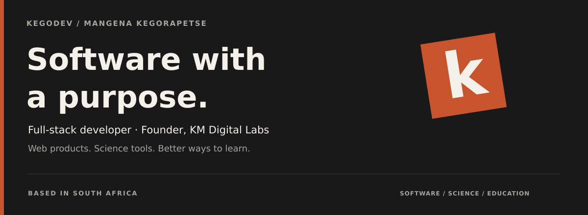
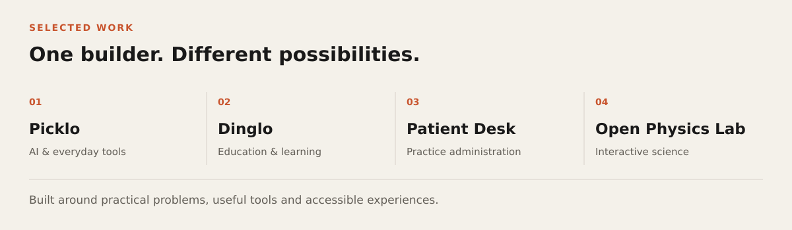
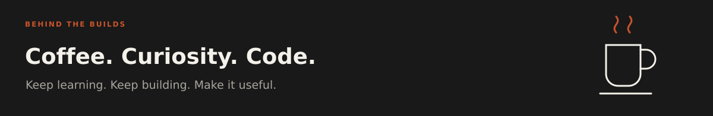

  

  <a href="https://kmdigitallabs.co.za"><strong>KM Digital Labs</strong></a> &nbsp; / &nbsp;
  <a href="mailto:services.kmdlabs@outlook.com">Email me</a> &nbsp; / &nbsp;
  <a href="https://www.instagram.com/kmdigitallabs/">Instagram</a>

## Hi, I’m Kegorapetse.

I’m a full-stack developer, the founder of **KM Digital Labs**, and a Physical Sciences student studying **Biochemistry and Chemistry**. I build web products for businesses, learning platforms for students, and interactive tools that bring science into the browser.

My work connects three interests: **software, science and education**. I enjoy turning practical problems into tools people can use.

## What I’m building

  

### Picklo
A browser-based AI assistant exploring memory, file handling and tools for everyday tasks.

[Explore the project ↗](https://github.com/kegodev/picklo)

### Dinglo Open Physics Lab
Interactive physics simulations for exploring concepts through experiments in the browser.

[Try the lab ↗](https://kegodev.github.io/open-physics-lab/) · [Source code](https://github.com/kegodev/open-physics-lab)

### Patient Desk
A patient-administration project for medical practices, built around authentication and controlled access to records.

[Explore the project ↗](https://github.com/kegodev/patient-desk)

### Biochemistry Labs
Browser-based biochemistry tools and laboratory utilities for science learning and analysis.

[Explore the project ↗](https://github.com/kegodev/biochemistry-labs)

## Tools I work with

**Web & interfaces**  
HTML · CSS · JavaScript · TypeScript · React · Next.js · Tailwind CSS

**Backend & data**  
Node.js · Python · Supabase · PostgreSQL

**Design & workflow**  
Figma · Git · GitHub · VS Code

## Let’s work together

Through **KM Digital Labs**, I build websites, online stores and custom digital tools. If you have a business to bring online or a useful product to build, let’s talk.

[Visit KM Digital Labs ↗](https://kmdigitallabs.co.za) · [Get in touch](mailto:services.kmdlabs@outlook.com)

  

